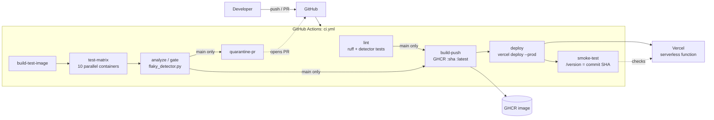

# Flaky Test Detection and Automatic Quarantine in a Containerized CI Pipeline

College DevOps mini project (KJSCE, Sem VII, LAB CA Activity 2).

A CI/CD pipeline for a small containerized FastAPI service. It runs the test suite **10 times in
parallel Docker containers** on GitHub Actions, classifies every test as **stable**, **flaky** or
**broken**, quarantines flaky tests automatically through a bot pull request, and **blocks the
build only on broken tests**. Code that passes the gate is released: the runtime image goes to GHCR,
the same commit is deployed to Vercel with the Vercel CLI, and a smoke test checks that the live
`/version` returns that exact commit SHA.

- Repository: <https://github.com/dhruvsaraf05/DevOps-LABCA>
- Live app: <https://quarantine-flaky-ci.vercel.app> (try `/health` and `/version`)
- Release image: `ghcr.io/dhruvsaraf05/devops-labca` (tags: commit SHA and `latest`, public)

## The problem

A flaky test passes and fails on the same code. Teams react by hitting "re-run" until the build is
green, so CI stops being trustworthy and real failures get ignored. Retrying hides the problem and
makes every build slower. This project makes flakiness visible, keeps it out of the way of the gate,
and still blocks on tests that are really broken.

## How tests are classified

Each test is counted over the 10 runs (`tools/flaky_detector.py`):

| Result over 10 runs | Class | Effect on the build |
|---|---|---|
| never failed | **stable** | none |
| failed in every run | **broken** | blocks the build (unless quarantined) |
| mixed results | **flaky** | does not block; added to `quarantine.json` through a PR |

For a test that fails with probability p = 0.3 per run, the chance it passes all 10 runs and escapes
detection is 0.7^10, about 2.8%. The chance it fails all 10 and is mistaken for broken is 0.3^10,
about 0.0006%.

## Architecture



More diagrams (pipeline flow, classification state diagram) are in
[docs/architecture.md](docs/architecture.md).

## Run it locally

Needs Python 3.12+ and Docker. On Windows, `make` comes from `winget install ezwinports.make`.

```bash
python -m venv .venv
source .venv/bin/activate        # Windows PowerShell: .venv\Scripts\Activate.ps1
pip install -e ".[dev]"
```

| Command | What it does |
|---|---|
| `make test` | Run the tests once. Tests listed in `quarantine.json` run as non-strict `xfail`. |
| `make test-n N=10` | Run the suite N times, one JUnit XML per run in `results/`. A failing run does not stop the loop. |
| `python tools/flaky_detector.py --results results/ --quarantine quarantine.json --out-json report.json --out-md report.md --write-quarantine quarantine.new.json` | Classify the runs, apply the gate, write the reports. |
| `ruff check .` | Lint. |
| `pytest tools/` | Unit tests for the detector. |
| `make docker-test` | Build the `test` image and run the tests in it. |
| `docker compose up` | Run the app on <http://localhost:8000>. |

With the committed `quarantine.json`, `make test` is green: the flaky tests show up as `xfail` or
`xpass`. Set `IGNORE_QUARANTINE=1` (as CI detection runs do) and they fail at random again.

## The app

A tiny in-memory Notes API. The pipeline is the project, not the app.

| Endpoint | Behaviour |
|---|---|
| `GET /health` | `{"status": "ok"}` |
| `GET /version` | The commit SHA: `GIT_SHA` env var if set, else `app/_version.py` (CI overwrites it before building) |
| `POST /notes` | Creates a note, returns **201** and the note |
| `GET /notes`, `GET /notes/{id}` | List / fetch (404 if missing) |
| `PUT /notes/{id}`, `DELETE /notes/{id}` | Update (200) / delete (204), 404 if missing |

## The three intentionally flaky tests

`tests/test_flaky.py` contains tests that are flaky on purpose, so there is real flakiness to
detect. They are not bugs. Do not fix them.

| Test | Category | Mechanism |
|---|---|---|
| `test_flaky_random_dependency` | Non-determinism | A simulated upstream call fails with probability `FLAKE_RATE` (default 0.3) |
| `test_flaky_timing` | Timing | A lookup is slow with probability `FLAKE_RATE`; the test asserts a tight 100 ms deadline |
| `test_flaky_order_dependent` | Shared state | Needs state left by another test; pytest-randomly shuffles the order, so it fails when it runs first (about 1 run in 3, **not** controlled by `FLAKE_RATE`) |

## Pipeline walkthrough (`.github/workflows/ci.yml`)

Runs on push and pull request to `main`. Permissions are `contents: read` unless a job needs more.

| Job | Runs on | What it does |
|---|---|---|
| `lint` | PR + main | `ruff check .` and the detector's unit tests |
| `build-test-image` | PR + main | Builds the Docker `test` target with the GitHub Actions cache, saves it as an artifact |
| `test-matrix` | PR + main | 10 parallel jobs. Each loads the image and runs pytest with `IGNORE_QUARANTINE=1`, writing `junit-N.xml`. The pytest step uses `continue-on-error`, because a failing test is data. |
| `analyze` | PR + main | Merges the 10 XML files, runs the detector, appends `report.md` to the job summary, uploads `flaky-report`. **Fails only if a non-quarantined test is broken.** |
| `quarantine-pr` | main, only if new flaky tests were found | Opens or updates the PR `bot/quarantine` that rewrites `quarantine.json` |
| `build-push` | main | Writes the SHA into `app/_version.py`, builds the `runtime` image, pushes `ghcr.io/dhruvsaraf05/devops-labca:<sha>` and `:latest` |
| `deploy` | main | Writes the SHA into `app/_version.py`, runs `vercel deploy --prod` using repository secrets, in the `production` environment |
| `smoke-test` | main | Polls `/version` every 10 s for up to 3 min until it returns this commit's SHA, then checks `/health` (200) and `POST /notes` (201, note in the body) |

`naive-ci.yml` is a manual workflow that runs pytest once with no detector and with quarantine
ignored. It exists only to show the "before" state.

## How quarantine works

1. On a push to `main`, the detector finds a flaky test that is not in `quarantine.json`.
2. It writes `quarantine.new.json` (existing entries kept, new ones added with flake rate, run count,
   commit and timestamp).
3. `quarantine-pr` opens a PR from `bot/quarantine`. The PR body is the full report.
4. A human reviews and merges the PR. From then on, normal runs (`make test`) mark that test as
   `xfail(strict=False)`, and the gate never blocks on it.
5. Detection runs always set `IGNORE_QUARANTINE=1`, so quarantined tests keep running and stay
   visible in every report under "Already quarantined". Quarantine never hides a failure.

To un-quarantine a test, fix it and remove its entry from `quarantine.json` in a PR.

## Demo scenarios

| Scenario | What it shows | Evidence |
|---|---|---|
| **A: Before** | `naive-ci` run repeatedly on identical code goes red and green at random |  |
| **B: Detection** | A PR adds a 4th flaky test. The matrix runs 10 times, the gate stays green, the report flags the new test, and after merge the bot opens a quarantine PR |    |
| **C: Real bug** | A PR makes `POST /notes` return 200. Two tests fail 10/10 (broken), the gate goes red, branch protection blocks the merge, nothing is deployed |   |
| **D: Delivery** | A harmless change is merged. `build-push`, `deploy` and `smoke-test` run, the live `/version` shows the new SHA and GHCR has the new tag |     |

## Design decisions and limitations

- **Docker is for tests, local runs and the GHCR release artifact. Vercel does not run Docker
  images.** Vercel builds the same commit from source as a serverless function.
- **Only CI deploys.** The Vercel project is not connected to the Git repository, so a push that
  fails the gate cannot reach production.
- **Serverless has no shared memory between requests.** The in-memory store does not persist in
  production, so smoke tests use single-request checks only. A real app would use a database.
- **Detection is probabilistic.** A test that fails rarely can slip through 10 runs. More runs mean
  better detection and more CI minutes.
- **Quarantine needs human follow-up.** It stops flaky tests blocking the build, it does not fix
  them.
- **Bot PRs do not trigger CI.** PRs created with the default `GITHUB_TOKEN` do not start workflow
  runs, so the required `lint` and `analyze` checks never report on the quarantine PR. The
  repository owner merges it with admin bypass. A personal access token or GitHub App would remove
  this limitation.
- **`vercel deploy --prebuilt` was tried and dropped.** The runner-built bundle was missing
  `pydantic_core`'s native module and crashed on Vercel, so the deploy step lets Vercel build
  remotely (the fallback in `PLAN.md`).

## Repository layout

```
app/            FastAPI app (main.py, store.py, external.py, _version.py)
tests/          stable API tests, intentionally flaky tests, quarantine-hook tests, conftest.py
tools/          flaky_detector.py (stdlib only) and its unit tests
quarantine.json source of truth for quarantined tests
Dockerfile      multi-stage: base -> test -> runtime (non-root)
docker-compose.yml, Makefile, pyproject.toml, vercel.json, .vercelignore
.github/workflows/  ci.yml, naive-ci.yml
docs/           architecture.md, REPORT.md, screenshots/
PLAN.md         the execution plan this project followed
```
