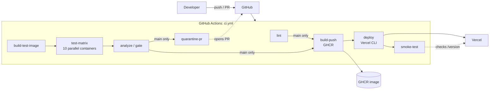
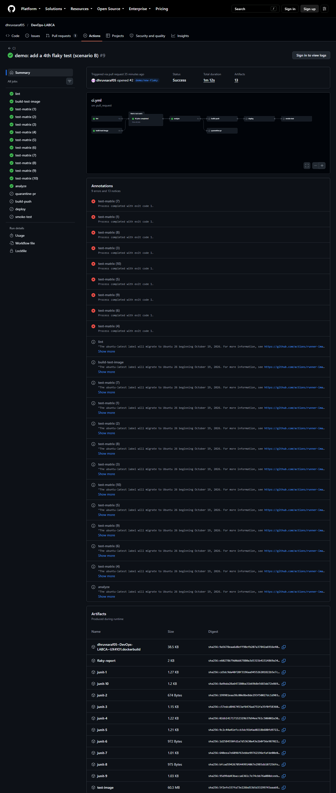
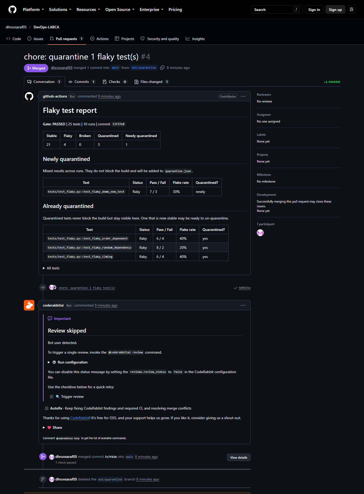
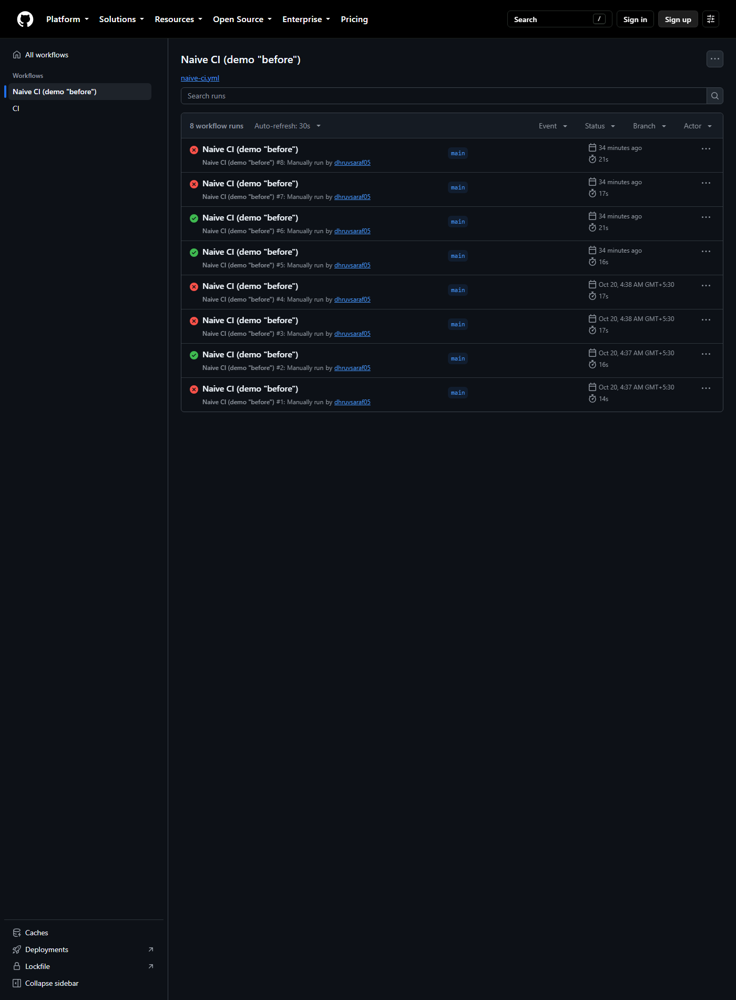
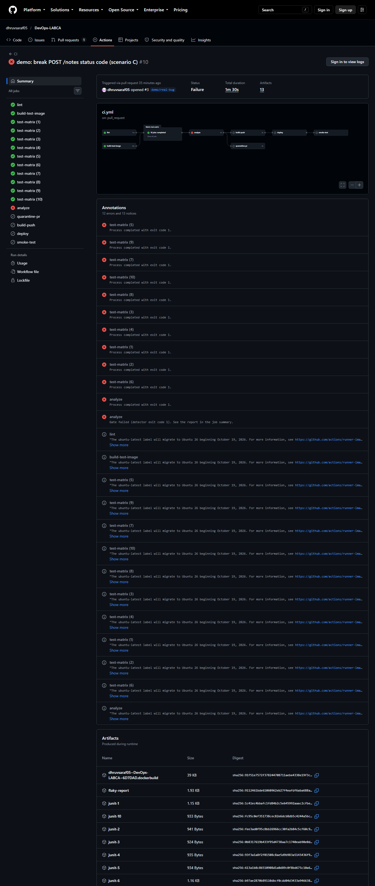
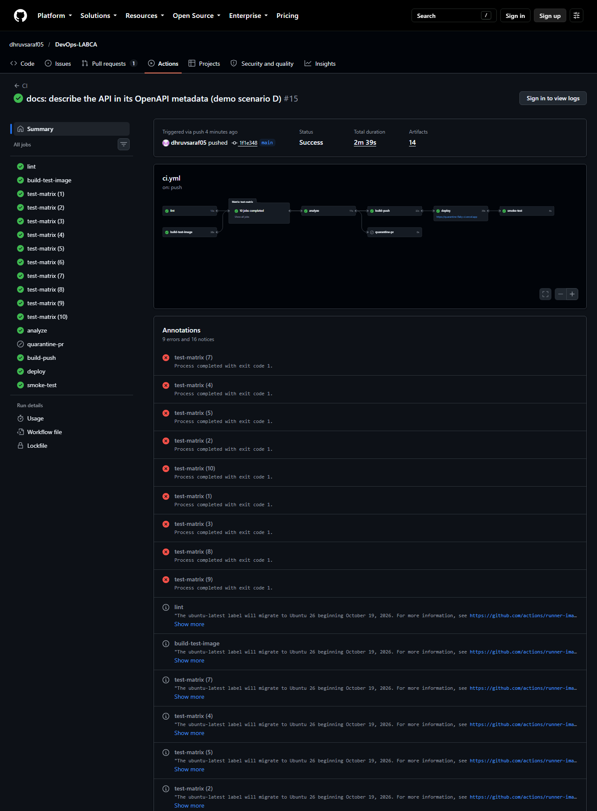
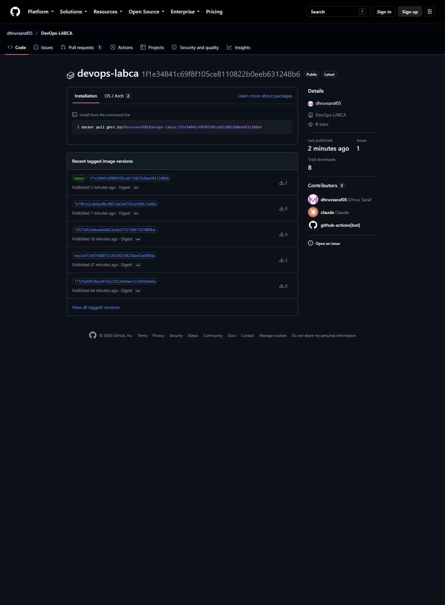

# Flaky Test Detection and Automatic Quarantine in a Containerized CI Pipeline Using Repeated Runs, Pytest and GitHub Actions

## Title page

| | |
|---|---|
| Course | DevOps (216U01E744), Semester VII |
| Activity | LAB CA Activity 2: Mini project |
| Institution | KJSCE |
| Team members and roll numbers | [fill in] |
| Faculty | [fill in] |
| Submission date | [fill in] |
| Repository | <https://github.com/dhruvsaraf05/DevOps-LABCA> |
| Live application | <https://quarantine-flaky-ci.vercel.app> |

---

## 1. Abstract

Flaky tests pass and fail on the same code. They make continuous integration (CI) untrustworthy,
because teams learn to re-run failed builds until they turn green and real failures get ignored.
This project builds a CI/CD pipeline for a containerized FastAPI service that makes flakiness
visible and keeps it from blocking releases. The pipeline runs the pytest suite ten times in
parallel Docker containers on GitHub Actions, classifies each test as stable, flaky or broken
from the JUnit results, records flaky tests in a `quarantine.json` file through an automatically
opened pull request, and blocks the build only when a non-quarantined test fails in every run.
Code that passes the gate is released: the runtime image is pushed to GitHub Container Registry
(GHCR), the same commit is deployed to Vercel with the Vercel CLI, and a smoke test checks that the
live `/version` endpoint returns the exact commit SHA. The whole system uses free tiers only.

## 2. Introduction and problem statement

A test is flaky when it gives different results for the same code. Common causes are
non-determinism (random values, unreliable network calls), timing and race conditions, and shared
state that depends on test order. A single flaky test is enough to turn a trusted CI signal into
noise.

The usual reaction is an automatic retry. Retrying has two costs: it hides the flakiness, so nobody
fixes it, and it makes every build slower for as long as the test exists. The alternative studied
here is to **detect** flakiness by repetition, **quarantine** the flaky test so it stops blocking
the build, keep it **visible** in every report, and still **block** on tests that are genuinely
broken.

**Problem statement.** Design and implement a containerized CI/CD pipeline that detects flaky
tests automatically, quarantines them through a reviewable change, blocks only on real failures,
and releases only code that passed that gate.

## 3. Objectives

1. Build a small containerized web service with an automated test suite.
2. Seed the suite with flaky tests that represent real flakiness categories.
3. Write a detector that classifies tests from repeated runs, using only the Python standard
   library.
4. Run the suite ten times in parallel containers in CI and apply a gate: block on broken tests,
   never on flaky ones.
5. Persist the quarantine through an automatically opened pull request.
6. Release only gated code: image to GHCR, deployment to Vercel, smoke test of the live version.
7. Demonstrate the behaviour with four scenarios (before, detection, real bug, delivery).
8. Stay within free tiers.

## 4. Background

**Flaky tests.** Luo et al. studied flaky-test fixes in open-source projects and grouped root causes
into categories such as asynchronous waiting, concurrency and test-order dependency [1]. Google
reported that a non-trivial share of its test failures came from flaky tests and described
mitigation through reruns and tracking [2]. Fowler describes non-determinism in tests as a
problem that erodes trust in a suite and recommends quarantining non-deterministic tests [3].

**Quarantine versus retry.**

| | Automatic retry | Quarantine (this project) |
|---|---|---|
| Flakiness visible? | No, the build just goes green | Yes, listed in every report |
| Build time | Slower on every flaky failure | Unaffected |
| Does it block on real bugs? | Only if the bug fails every retry | Yes, a test failing every run blocks |
| Follow-up | Easy to forget | A pull request records it for review |
| Risk | Hides regressions that fail intermittently | A quarantined test can hide a real bug, so it stays listed and runs every time |

**Test-order shuffling.** `pytest-randomly` shuffles the order of tests on every run. A test that
secretly depends on state left by another test then passes or fails depending on the order, which
exposes the dependency.

## 5. System architecture



The pull-request path runs `lint`, `build-test-image`, `test-matrix` and `analyze`. The release
path (`quarantine-pr`, `build-push`, `deploy`, `smoke-test`) runs only on push to `main`, after the
gate. A manual workflow, `naive-ci.yml`, runs pytest once with no detector and is used only to show
the "before" state. More diagrams are in [architecture.md](architecture.md).

**Where Docker and Vercel fit.** Docker is the test environment (all ten matrix runs use the same
image) and the release artifact in GHCR. Vercel does not run Docker images: it builds the same
commit from source and runs it as a serverless function. Both carry the same commit SHA, written
into `app/_version.py` before each build.

## 6. Tools and technologies

| Layer | Choice | Why |
|---|---|---|
| Language and framework | Python 3.12, FastAPI, Uvicorn | Small, typed, easy to test |
| Tests | pytest, pytest-randomly, httpx (`TestClient`) | Random order exposes order dependence |
| Lint | ruff | Fast, one tool |
| Detector | Python standard library only (`xml.etree`, `json`, `argparse`) | No dependencies, simple to explain |
| Container | Multi-stage Dockerfile: `base`, `test`, `runtime` (non-root) | Dev tools never reach the release image |
| CI/CD | GitHub Actions | Free for public repositories, matrix builds |
| Registry | GHCR (public package) | Free, tied to the repository |
| Deployment | Vercel Hobby plan, deployed by the Vercel CLI from CI | Free; CI is the only deployer |
| Local | Docker Compose, Makefile | Same commands as CI |

## 7. Implementation

### 7.1 The application

A Notes API with `/health`, `/version` and CRUD on `/notes`, backed by an in-memory store
(`app/store.py`). `POST /notes` returns 201 and the created note. `/version` returns the `GIT_SHA`
environment variable if set, otherwise `GIT_SHA` from `app/_version.py`, which CI overwrites with
the commit SHA. The app is intentionally tiny; the pipeline is the project.

### 7.2 Tests

| File | Content |
|---|---|
| `tests/test_notes_api.py` | 15 test functions (17 test cases with parametrization), all stable, order-independent (an autouse fixture resets the store) |
| `tests/test_flaky.py` | The seeded flaky tests (below) |
| `tests/test_quarantine_hook.py` | 4 tests of the quarantine hook, run in a temporary project with pytest's `pytester` |
| `tools/test_flaky_detector.py` | 25 unit tests of the detector on small synthetic JUnit XML files |

**Seeded flaky tests.**

| Test | Category | Mechanism |
|---|---|---|
| `test_flaky_random_dependency` | Non-determinism | A simulated upstream call fails with probability `FLAKE_RATE` (default 0.3) |
| `test_flaky_timing` | Timing | A lookup is slow (0.2 s) with probability `FLAKE_RATE`; the test asserts a 0.1 s deadline |
| `test_flaky_order_dependent` | Shared state | Passes only if one of the two tests above already ran (they record `store.last_operation`, which the store reset does not clear). With random order it runs first about 1 time in 3. This rate is a property of the test order, not of `FLAKE_RATE`. |

The simulated operations use `random.SystemRandom`, because `pytest-randomly` re-seeds the global
`random` module before every test, which would otherwise make the draws repeatable.

### 7.3 Docker

The Dockerfile has three stages. `base` installs only the runtime dependencies (read from
`pyproject.toml`) and copies `app/`. `test` builds on `base`, adds the dev dependencies, `tests/`
and `quarantine.json`, and runs pytest. `runtime` also builds on `base`, creates a non-root user,
exposes port 8000 and runs Uvicorn. Because `runtime` does not build on `test`, pytest, ruff and
httpx are absent from the release image. This was checked by running `import pytest` inside the
running container, which fails.

### 7.4 The detector (`tools/flaky_detector.py`)

Input: a directory of JUnit XML files, one per run. Output: `report.json`, `report.md` and an
updated quarantine file.

1. **Parse.** Each `<testcase>` becomes a pytest node id (`tests/test_flaky.py::test_flaky_timing`)
   from its `classname` and `name`. A `<failure>` or `<error>` child means failed, `<skipped>`
   means not run, anything else means passed.
2. **Classify.** Counted over the runs in which the test executed: no failures means *stable*,
   no passes means *broken*, otherwise *flaky* with `flake_rate = failed / runs`.
3. **Gate.**
   - Broken and not quarantined: **exit 1**, the build is blocked.
   - Flaky and not quarantined: marked *newly quarantined*, does not block.
   - Already quarantined: never blocks, always listed in the report.
4. **Input errors** (no XML files, unreadable XML, a test missing from some runs, malformed
   quarantine file) produce an error report and **exit 2**, and the quarantine file is not
   rewritten. This is an addition: a broken input must not look like a passing gate.
5. **Write outputs.** A Markdown report (summary counts, then sections for broken, newly
   quarantined and already quarantined tests, then a collapsible table of all tests), a JSON
   report, and a new quarantine file with existing entries kept and new ones appended.

`quarantine.json` entry:

```json
{
  "id": "tests/test_flaky.py::test_flaky_timing",
  "flake_rate": 0.2,
  "runs": 10,
  "detected_at": "2026-10-19T23:12:58Z",
  "commit": "ebcf46cbf8305d7103b38d1931eb3b7be0e5a316",
  "reason": "mixed results across repeated runs"
}
```

### 7.5 Raw detection runs and quarantine at the gate

Detection runs set `IGNORE_QUARANTINE=1`, so pytest reports true results. Quarantine is applied at
the gate, never by hiding failures. For normal runs (`make test`), a hook in `tests/conftest.py`
marks quarantined tests with `xfail(strict=False)`, so they appear as `xfail` or `xpass`.

### 7.6 CI/CD jobs (`.github/workflows/ci.yml`)

| Job | Details |
|---|---|
| `lint` | `ruff check .` and `pytest tools/` |
| `build-test-image` | `docker/build-push-action` with the GitHub Actions cache, `target: test`, then `docker save \| gzip` uploaded as an artifact |
| `test-matrix` | Matrix `run: 1..10`, `fail-fast: false`. Loads the image and runs pytest in a container with `IGNORE_QUARANTINE=1` and `FLAKE_RATE=0.3`, writing `junit-N.xml` to a mounted folder. The pytest step has `continue-on-error: true`, so the job reports results, not failure. Each job uploads its XML. |
| `analyze` | Downloads all `junit-*` artifacts into one folder, runs the detector, appends `report.md` to the job summary, uploads `flaky-report`, and fails with the detector's exit code. Exposes `newly_quarantined` as a job output. |
| `quarantine-pr` | Push to main only, only if `newly_quarantined` is not 0. Replaces `quarantine.json` with the detector's output and opens or updates the PR `bot/quarantine` with `peter-evans/create-pull-request`. The PR body is the report. |
| `build-push` | Push to main, needs `analyze` and `lint`. Writes the SHA to `app/_version.py`, logs in to GHCR with `GITHUB_TOKEN` (`packages: write` for this job only), builds `--target runtime` and pushes `:<sha>` and `:latest`. |
| `deploy` | Needs `build-push`. Environment `production` with the live URL. Writes the SHA to `app/_version.py` and runs `vercel deploy --prod --yes`. Credentials (`VERCEL_TOKEN`, `VERCEL_ORG_ID`, `VERCEL_PROJECT_ID`) come from repository secrets and are never printed. |
| `smoke-test` | Polls `/version` every 10 s for up to 3 minutes until it equals the commit SHA, then checks `/health` returns 200 and `POST /notes` returns 201 with the note in the body. Single-request checks only. |

Other decisions: minimal `permissions:` (`contents: read` at workflow level), concurrency groups
that cancel superseded runs on pull requests but queue runs on `main` so a release is not cancelled
midway, and a Vercel project that is **not** connected to the Git repository so that only the gated
`deploy` job can release.

### 7.7 Branch protection

`main` requires a pull request and the `lint` and `analyze` checks to pass. Admin enforcement is
off, which lets the repository owner merge the bot's quarantine PR (see Limitations).

### 7.8 Problems met during implementation

| Problem | Cause | Resolution |
|---|---|---|
| First deploy job failed: `uv is required but was not found` | `vercel build` uses `uv` for Python projects and the runner had none | Installed `uv` in the job |
| Second failure: `ENOENT ... tests/conftest.py` | The prebuilt bundle included `tests/` and `tools/`, which `.vercelignore` excludes from the upload | Excluded them in `vercel.json` |
| Production returned HTTP 500 after the prebuilt deploy | The runner-built bundle lacked `pydantic_core`'s native module, so the function failed on import | Used the fallback in `PLAN.md`: `vercel deploy --prod`, letting Vercel build remotely. The next deploy restored service and the smoke test passed. |
| The `naive-ci` "before" demo would turn green once quarantine existed | `make test` applies quarantine | `naive-ci` sets `IGNORE_QUARANTINE=1` |

## 8. Results

All results below come from real runs in this repository.

### 8.1 Local repeated runs

Across 40 local runs, before quarantine: `test_flaky_random_dependency` failed 14 times (35%),
`test_flaky_timing` 9 times (22%) and `test_flaky_order_dependent` 9 times (22%). All 17 stable API
tests passed every run.

### 8.2 Detection in CI (scenario B, pull request run)

A pull request added a fourth flaky test. The matrix ran ten times and the detector reported:

**Gate: PASSED**, 25 tests, 10 runs.

| Test | Class | Pass / Fail | Flake rate | Quarantined? |
|---|---|---|---|---|
| `test_flaky_demo_new_test` | flaky | 7 / 3 | 30% | newly quarantined |
| `test_flaky_order_dependent` | flaky | 5 / 5 | 50% | yes |
| `test_flaky_random_dependency` | flaky | 6 / 4 | 40% | yes |
| `test_flaky_timing` | flaky | 8 / 2 | 20% | yes |
| 21 other tests | stable | 10 / 0 | 0% | no |

After the merge, the pipeline opened the PR "chore: quarantine 1 flaky test(s)", which added the new
test to `quarantine.json`. Once it was merged, the next run listed all four tests as already
quarantined and opened no new PR.





### 8.3 Before: no detector (scenario A)

The manual `naive-ci` workflow runs pytest once. Eight runs on the same code: 5 failed and 3 passed.



### 8.4 A real bug is blocked (scenario C)

A pull request changed `POST /notes` to return 200 instead of 201. The detector reported:

**Gate: BLOCKED**, 24 tests, 10 runs.

| Test | Class | Pass / Fail | Quarantined? |
|---|---|---|---|
| `test_create_note_content_is_optional` | broken | 0 / 10 | no |
| `test_create_note_returns_created_note` | broken | 0 / 10 | no |

The `analyze` job failed and branch protection blocked the merge, so the bug never reached `main`.
The release jobs (`build-push`, `deploy`, `smoke-test`) run only on `main`, so nothing was
published and the Vercel dashboard shows no deployment for this change. The quarantined flaky
tests were still listed and did not affect the result.




### 8.5 Delivery (scenario D)

A harmless change (API description text) was merged through a pull request. All jobs passed:
`lint`, `build-test-image`, ten `test-matrix` jobs, `analyze`, `build-push`, `deploy` and
`smoke-test`. The live `/version` returned the commit SHA of that merge, and GHCR had the image
tagged with the same SHA and `latest`.






### 8.6 Pipeline timing

| Run | Duration |
|---|---|
| Pull request, gate passes (scenario B) | 72 s |
| Pull request, gate blocks (scenario C) | 90 s |
| Push to main, full release chain (scenario D) | 159 s |

## 9. Probability analysis: why 10 runs

Let p be a flaky test's per-run failure probability. With N independent runs:

- It escapes detection (passes all N runs): (1 - p)^N.
- It is mistaken for broken (fails all N runs): p^N.

| p | N = 5 | N = 10 | N = 20 |
|---|---|---|---|
| 0.3: escapes detection | 16.8% | **2.8%** | 0.08% |
| 0.3: mistaken for broken | 0.24% | **0.0006%** | about 0 |
| 0.1: escapes detection | 59.0% | 34.9% | 12.2% |

At p = 0.3, ten runs detect the test about 97% of the time, and a misclassification as broken is
practically impossible. More runs improve detection of rare flakes but cost CI minutes, since each
run is a separate parallel job. Tests that fail rarely (p = 0.1) can still escape a 10-run
check, which is a stated limitation. The independence assumption is also approximate: runs share the
same code and image, and only the seeded randomness differs.

## 10. Limitations and future scope

**Limitations**

- **Detection is probabilistic.** Tests with low flake rates can pass all 10 runs.
- **Quarantine can hide a real bug.** The mitigation is that quarantined tests keep running, stay
  listed in every report and change only through a reviewable pull request. A quarantined test that
  starts failing 10/10 does not block.
- **Quarantine needs human follow-up.** The system stops flaky tests blocking the build; it does
  not fix them.
- **CI minutes.** Ten matrix jobs per run use more minutes than a single run.
- **The bot's pull request gets no CI checks.** Pull requests created with the default
  `GITHUB_TOKEN` do not trigger workflows, so the required `lint` and `analyze` checks never
  report on the quarantine PR. The repository owner merged it with admin bypass.
- **No persistent storage in production.** Vercel runs the app as a serverless function, so the
  in-memory store does not persist across requests. This is why the smoke test uses single-request
  checks only.
- **Vercel does not run the Docker image.** The GHCR image is a release artifact that runs
  locally or on any container host.
- **The order-dependent flaky test** is controlled by test order, not by `FLAKE_RATE`.
- **Remote-build deploy.** The deployed bundle is built by Vercel, not the exact bytes built in CI.
  The commit and SHA are identical, which the smoke test verifies.

**Future scope**

- Use a database (for example Postgres) so the deployed API is stateful and the smoke test can
  create and read back a note.
- Open the quarantine PR with a token or GitHub App so required checks run on it.
- Suggest un-quarantining a test that passes 10/10 on `main` for several consecutive runs.
- Keep a flakiness history file and show the trend in the report.
- Add a pull request comment with the flaky report.
- Add a job using `pytest-rerunfailures` to compare retries (green but hidden) with this approach
  (visible and tracked).

## 11. Conclusion

The pipeline detects flaky tests by repetition in identical containers, quarantines them through a
reviewable pull request, keeps them visible in every report, and blocks only on tests that are
broken. The four scenarios show the whole behaviour on real runs: random red and green without the
system, a new flaky test detected without blocking, a real bug blocked from merging and deploying,
and a clean change released to GHCR and Vercel with the live version checked against the commit
SHA.

## 12. References

[1] Q. Luo, F. Hariri, L. Eloussi and D. Marinov, "An Empirical Analysis of Flaky Tests,"
*Proc. 22nd ACM SIGSOFT International Symposium on Foundations of Software Engineering (FSE)*,
2014. <https://doi.org/10.1145/2635868.2635920>

[2] J. Micco, "Flaky Tests at Google and How We Mitigate Them," Google Testing Blog, 2016.
<https://testing.googleblog.com/2016/05/flaky-tests-at-google-and-how-we.html>

[3] M. Fowler, "Eradicating Non-Determinism in Tests," 2011.
<https://martinfowler.com/articles/nonDeterminism.html>

[4] pytest documentation. <https://docs.pytest.org>

[5] pytest-randomly. <https://github.com/pytest-dev/pytest-randomly>

[6] FastAPI documentation. <https://fastapi.tiangolo.com>

[7] GitHub Actions documentation. <https://docs.github.com/actions>

[8] GitHub Container registry documentation. <https://docs.github.com/packages>

[9] Vercel documentation: deploying FastAPI and the Vercel CLI. <https://vercel.com/docs>
