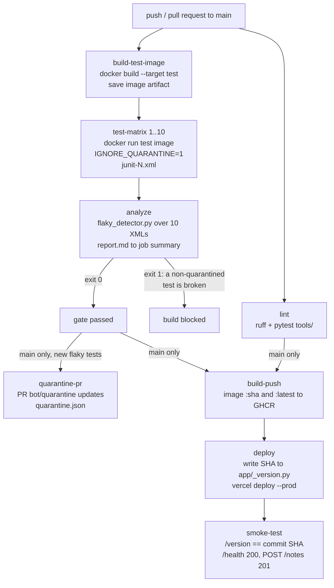
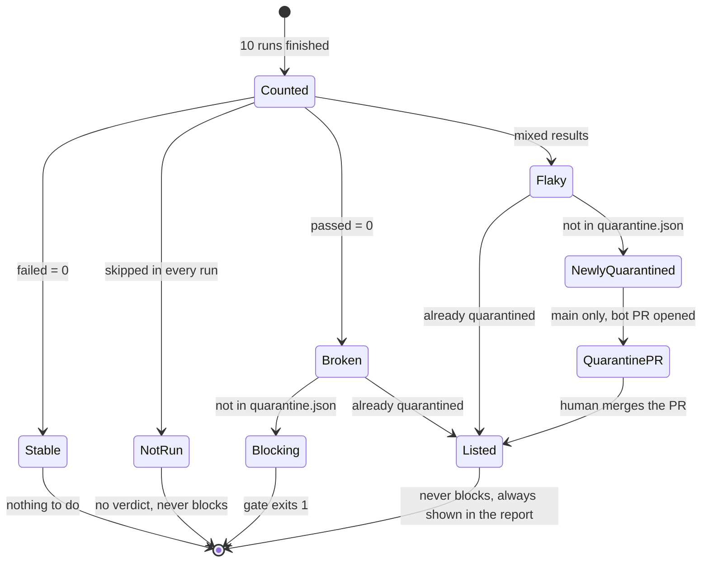
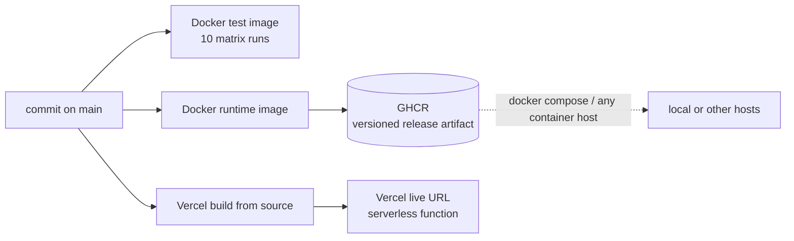
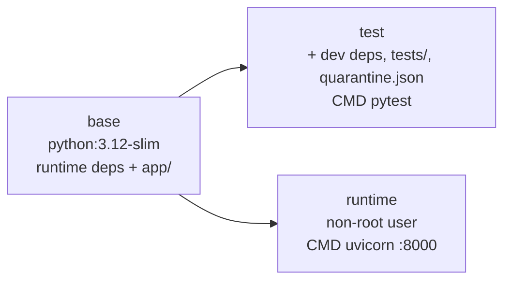

# Architecture

## 1. Pipeline flow (`ci.yml`)

`needs` edges are real job dependencies. Jobs marked "main only" run on push to `main`, not on pull
requests. `test-matrix` is 10 parallel jobs.

Deploys are never triggered by Vercel's Git integration. Only the `deploy` job, after the gate,
can release to production.

## 2. Classification and quarantine state diagram

The state of a test as seen by the detector and the repository over time.

Rules, as implemented in `tools/flaky_detector.py`:

| Condition | Result | Exit code |
|---|---|---|
| Broken and not quarantined | Blocks the build | 1 |
| Flaky and not quarantined | "Newly quarantined", does not block | 0 |
| Already quarantined (any status) | Listed in the report, never blocks | 0 |
| Empty results, unreadable XML, a test missing from some runs, malformed quarantine file | Error report, quarantine file not rewritten | 2 |

## 3. Where each environment fits

Vercel does not run Docker images. The image in GHCR is the portable, SHA-tagged release artifact.
Vercel builds the same commit from source. Both carry the same SHA, baked into `app/_version.py`
before each build.

## 4. Docker stages

`runtime` builds from `base`, not from `test`, so pytest, ruff and httpx never reach the release
image.
